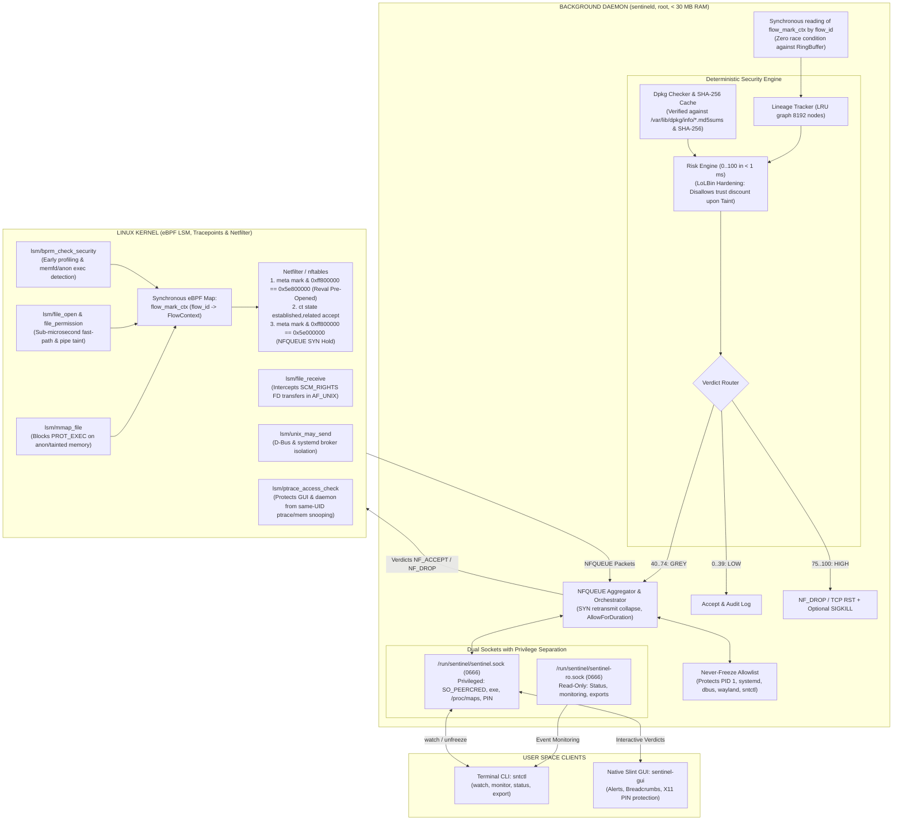

# Sentinel-RS

**eBPF Desktop Anti-Stealer & Deterministic Context-Aware Firewall for Linux**

[](https://www.rust-lang.org/)
[-blue.svg?logo=linux)](https://ebpf.io/)
[](https://slint.dev/)
[](https://github.com/woifik560/sentinel-rs)
[](#key-features)
[](https://www.debian.org/)

**English** | [Русский](README.md)

---

## About the Project (Version 2.0)

**Sentinel-RS** is an ultra-lightweight host firewall and integrity monitor for Linux Desktop specifically engineered for **deterministic prevention of unauthorized credential exfiltration** by unprivileged user-space processes and Infostealers.

### Threat Model Boundaries
Sentinel-RS protects sensitive user data (`~/.ssh`, browser profiles/cookies, Telegram `tdata`, cryptocurrency wallets) from malicious code executed under the same user UID (including npm/pip/cargo build scripts, phishing payloads, and browser extensions):
* **Within Scope**: Isolation of unprivileged user processes, taint-tracking across pipes, AF_UNIX sockets, and `ptrace`, network hold on new and pre-opened connections, cryptographic integrity enforcement.
* **Out of Scope / Architectural Constraints**:
  * *Root Compromise*: If malware gains root access (`sudo` or kernel exploitation), host security is fundamentally compromised at the kernel level.
  * *X11 Session Limitations*: In X11 sessions, process window and input isolation are absent by design (`XGetImage`, key snooping). Sentinel-RS mitigates clickjacking with a one-time PIN and lockout after 3 failed attempts, but **Wayland is required for complete graphical isolation**.

Unlike traditional packet filters (`iptables`, `nftables`, `ufw`) that lack data provenance context, or bloated endpoint agents with opaque heuristics or nondeterministic LLMs, Sentinel-RS combines:
1. **eBPF In-Kernel Object Storage**:
   - Replaces legacy PID/TGID maps with `BPF_MAP_TYPE_TASK_STORAGE`, `BPF_MAP_TYPE_INODE_STORAGE`, and `BPF_MAP_TYPE_SK_STORAGE`. This eliminates memory leaks and PID reuse race conditions.
   - **Cross-Thread Taint Propagation (`task->group_leader`)**: Taint state is anchored to the thread group leader, ensuring that if Thread A reads a secret, network sockets across all sibling threads (Go goroutines, Tokio, Python, Node.js) are immediately blocked.
2. **End-to-End Data Flow Taint Tracking & Anti-Bypass Hooks**:
   - `lsm/file_permission`: Tracks secret leakage across pipes (`cat ~/.ssh/id_rsa | curl ...`), FIFOs, and temporary files (`/tmp`).
   - `lsm/file_receive`: Tracks file descriptor passing between processes via `SCM_RIGHTS` over AF_UNIX domain sockets.
   - `lsm/mmap_file`: Tracks memory mappings of protected files; blocks execution (`PROT_EXEC`) on anonymous or tainted memory while maintaining full compatibility with legitimate JIT runtimes (V8, SpiderMonkey, JVM, Node.js).
   - `lsm/unix_may_send` & `LineageTracker`: Prevents taint laundering across AF_UNIX sockets and closes D-Bus broker escapes (`systemd-run`, `org.freedesktop.systemd1`, portals) by causal lineage linking.
   - `lsm/ptrace_access_check` & Kernel Self-Defense: Blocks `ptrace`, `process_vm_readv/writev`, and `/proc/<pid>/mem` access against both `sentineld` and `sentinel-gui` from any process running under the same user UID.
3. **Harmonized Network Hook Ordering & Fast-Path / Slow-Path Separation**:
   - *Kernel Hook Ordering*: Accounts for the fact that `cgroup_skb/egress` executes in `ip_finish_output()` (after Netfilter output/postrouting chains). Sentinel-RS applies a two-phase architecture:
     1. In `lsm/socket_sendmsg` syscall context: returns `-EPERM` immediately for HIGH-risk processes, preventing packet creation.
     2. In `cgroup/sendmsg4|6`, `cgroup/connect4|6`, and `sock_ops`: sets `SO_MARK` via `bpf_setsockopt` directly on the socket structure **before** Netfilter traversal.
     3. In `cgroup_skb/egress`: immediately drops packets (`return 0`) as a hardware-like fail-safe for tainted tasks with queued packets.
   - *Synchronous Dynamic Mark Correlation with Zero Bit Collisions*:
     - Bits `[31:24]` = `0x5E` (Sentinel magic byte)
     - Bit `[23]` = `0x00800000` (`REVAL_PREOPENED` flag)
     - Bits `[22:0]` = `flow_id` (up to 8.3M active concurrent flows)
     - New flow mark: `0x5E000000 | flow_id`
     - Revalidation mark: `0x5E800000 | flow_id`
     - In-kernel context is synchronously saved in `flow_mark_ctx` map by `flow_id` before packet departure.
   - *Netfilter Rules with Queue Bypass Resilience*:
     1. `meta mark & 0xff800000 == 0x5e800000 counter queue num 100 bypass` (Reval Pre-Opened)
     2. `ct state established,related accept` (Line-speed kernel fast-path)
     3. `ct state new meta mark & 0xff800000 == 0x5e000000 counter queue num 100 bypass` (New SYN hold)
     The `bypass` flag ensures that if the daemon is stopped or crashes, system network traffic is not locked up indefinitely.
4. **LoLBin Hardening & TOFU**:
   - Package integrity provider abstraction (`PkgIntegrityProvider`): uses MD5 solely as a membership indicator, with local SHA-256 caching as the authoritative cryptographic standard.
   - Package trust discount (`-35`) is invalidated whenever a secret is accessed (`SECRET_NON_OWNER`) or when run via piped stdin or inline arguments.
   - **Trust On First Use (TOFU)** for external tools (`~/.cargo/bin`, Flatpak, AppImage, local user builds).
5. **Dual-Socket Architecture & Strict GUI Peer Verification (P0)**:
   - **Dual Unix Domain Sockets**:
     - `/run/sentinel/sentinel-ro.sock` (0666): Public read-only socket for monitoring, status queries, and forensic exports (`sntctl monitor`, `sntctl status`, `sntctl export`).
     - `/run/sentinel/sentinel.sock` (0666, authenticated post-accept): Management socket accessible to unprivileged desktop GUI session without kernel `EACCES` errors.
   - **Strict Peer Verification & TOCTOU Defense**:
     - Validates `SO_PEERCRED` (`uid` and `pid`). Root granted administrative rights.
     - Resolves canonical `/proc/<pid>/exe`, checks root ownership (`uid == 0`), non-writable permissions (`mode & 0o022 == 0`), and SHA-256.
     - Inspects `/proc/<pid>/environ` to verify absence of `LD_PRELOAD`, `LD_AUDIT`, `LD_LIBRARY_PATH`.
     - **Anti-TOCTOU `/proc/<pid>/maps` Inspection**: Even if a hostile library's constructor wiped `environ` in memory prior to `connect()`, the daemon inspects process memory maps. Executable mappings (`r-xp`) from `/tmp`, `/dev/shm`, `~`, or deleted files immediately terminate authorization.
   - **X11 Anti-Clickjacking Defense**: Detects X11 sessions, mandates entering an ephemeral 4-digit PIN, and locks out the prompt after 3 failed attempts.
     - Inspects `/proc/<pid>/environ` to verify absence of `LD_PRELOAD` / `LD_AUDIT`.
     - **Anti-TOCTOU `/proc/<pid>/maps` Inspection**: Even if a hostile library's constructor wiped `environ` in memory prior to `connect()`, the daemon inspects process memory maps. Executable mappings (`r-xp`) from `/tmp`, `/dev/shm`, `~`, or deleted files immediately terminate authorization.
   - **X11 Anti-Clickjacking Defense**: Detects X11 sessions and mandates entering an ephemeral 4-digit PIN for sensitive prompt actions.
6. **Never-Freeze Allowlist & DoS Defense**:
   - Hardcoded protection list (PID 1, `systemd*`, `dbus*`, `gnome-shell`, `kwin*`, `sway`, `hyprland`, `pipewire`, `NetworkManager`, `sntctl`).
   - Anti-Spoofing: Validation strictly based on `(dev, inode)` and canonical binary path. Spoofing `comm` via `prctl(PR_SET_NAME)` is ignored.
   - NFQUEUE queue saturation defense (`pending_queue_size = 512`, duplicate SYN retransmit aggregation, `AllowForDuration` temporary approval).
   - **Kernel Requirements & CVE-2026-64192**: Checking for `bpf` presence in `/sys/kernel/security/lsm` on kernels 6.1.184+ provides verified protection against CVE-2026-64192, as the kernel patch secures `map_type_inode_storage` operations.

> **V2.0 Architectural Rule:** 100% Pure Rust. Zero C/Python runtime dependencies, zero LLMs in the security critical loop! Deterministic scoring in **< 1 millisecond**, memory footprint **< 25–30 MB RAM**.

---

## Kernel Setup & GRUB Configuration

Sentinel-RS requires BPF LSM hooks to be enabled at kernel boot.

### Ubuntu / Debian Setup:
1. Open `/etc/default/grub` with root privileges:
   ```bash
   sudo nano /etc/default/grub
   ```
2. Ensure `bpf` is included in the `lsm` boot parameter under `GRUB_CMDLINE_LINUX`:
   ```bash
   GRUB_CMDLINE_LINUX="lsm=landlock,lockdown,yama,apparmor,bpf"
   ```
3. Update GRUB and reboot:
   ```bash
   sudo update-grub
   sudo reboot
   ```
4. Verify BPF LSM activation:
   ```bash
   cat /sys/kernel/security/lsm
   # 'bpf' must be present in the output
   ```

---

## Architecture Diagram



---

## Risk Scoring Weights

| Rule | Weight | Description |
|---|:---:|---|
| `FILELESS_MEMFD` | **+50** | Anonymous memory execution (`memfd_create`) |
| `FILELESS_ANON_EXEC` | **+35** | Memory execution via `mmap` with `PROT_EXEC` on deleted/tmpfs file |
| `SECRET_NON_OWNER` | **+40** | Unauthorized secret access or taint inherited via pipe/file/SCM_RIGHTS |
| `UNTRUSTED_BINARY_ORIGIN` | **+25** | Executable launched from `/tmp`, `/dev/shm`, `~/Downloads`, or unverified in `dpkg` |
| `SUSPICIOUS_SCRIPT_EXECUTION` | **+25** | Script execution from anonymous sources, stdin, or suspicious flags |
| `SUSPICIOUS_INTERPRETER` | **+20** | Interpreter launched with inline code (`-c`, `-e`), eval, base64, or pipe |
| `FIRST_SEEN_DESTINATION` | **+15** | First connection to external public IP outside RFC1918 / loopback |
| `FAST_EXFIL_BURST` | **+15** | Network connection initiated within <= 5s of secret access |
| `RAW_IP_CONNECT` | **+10** | Direct IP connection without preceding DNS query |
| `TRUSTED_PACKAGE_CONTEXT` | **-35** | Binary verified in `dpkg` by SHA-256 (**Disallowed upon Taint or pipe!**) |

---

## CLI Usage (`sntctl`)

Renamed from `sentinelctl` to `sntctl` to prevent namespace collision with SentinelOne:

```bash
# Real-time interactive triage (for servers and SSH) [Requires Root]
sudo sntctl watch

# Live firewall event monitor [Read-Only, no root needed]
sntctl monitor

# Check daemon health and statistics [Read-Only, no root needed]
sntctl status

# Unfreeze process [Requires Root]
sudo sntctl unfreeze <TGID>

# Export forensic incident report as JSON [Read-Only]
sntctl export <INCIDENT_ID> --format json

# Manage application whitelist
sntctl whitelist list
sudo sntctl whitelist add /usr/bin/curl

# Run full system diagnostics and security preflight
sntctl doctor
```
