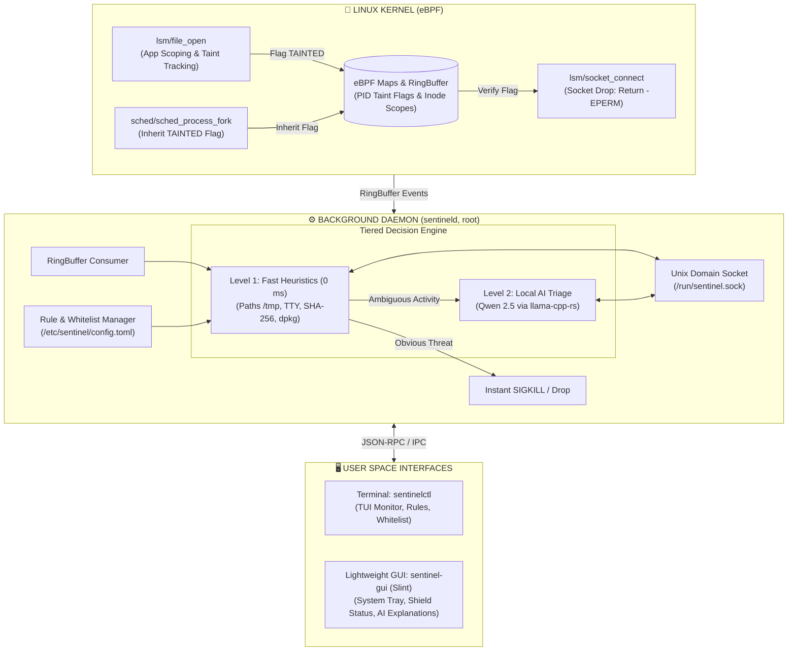

# 🛡️ Sentinel-RS

**eBPF Desktop Anti-Stealer & Local AI Triage Firewall for Linux**

[](https://www.rust-lang.org/)
[-blue.svg?logo=linux)](https://ebpf.io/)
[](https://slint.dev/)
[-green.svg)](https://huggingface.co/Qwen)
[](LICENSE)
[](https://www.debian.org/)

**English** | [Русский](README.md)

---

## 📌 Overview

**Sentinel-RS** is an ultra-lightweight hybrid host firewall and data-exfiltration defense system designed for Linux Desktop environments. It focuses on detecting and mitigating **infostealers** and unauthorized credential exfiltration attempts.

Unlike traditional packet filters (`iptables`, `nftables`, `ufw`), which lack awareness of process data origins, Sentinel-RS introduces **in-kernel Taint Tracking** via **eBPF LSM**.

When an unauthorized process attempts to read sensitive files (Telegram desktop sessions, browser cookies, private SSH keys, cryptocurrency wallets), the Linux kernel marks the process as `TAINTED`. The moment the process attempts to open an outbound socket, the network request is **instantly rejected (`-EPERM`)** without freezing user desktop sessions, while metadata is evaluated by a **two-tier decision engine**: ultra-fast static heuristics combined with an offline local neural network (**Qwen 2.5 0.5B/1.5B**) that provides human-readable security explanations without exposing data to the cloud.

---

## ✨ Key Features

- 🔒 **eBPF LSM Taint Tracking & App Scoping**: Access control based on "Secret Ownership" (Telegram can only access Telegram sessions, Chrome can only access Chrome cookies).
- 🧬 **Taint Inheritance**: Automatic propagation of the `TAINTED` flag to child processes via the `sched/sched_process_fork` hook, preventing evasion through sub-process spawning.
- 🛑 **Non-Blocking Network Drop**: Returns `-EPERM` at the kernel socket layer upon unauthorized outbound traffic, isolating exfiltration without causing desktop UI hangs.
- ⚡ **Two-Tier Decision Engine**:
  - **Level 1 (Fast Heuristics, 0 ms)**: Real-time static inspection (execution from `/tmp`, hidden paths, absence of TTY) and binary integrity verification (SHA-256 vs. `dpkg` database).
  - **Level 2 (Local AI Triage)**: Compact **Qwen 2.5** model via `llama-cpp-rs` to analyze ambiguous ("gray zone") behavior and provide clear explanations for desktop users.
- 🪶 **Extreme Lightweight Design**:
  - Background daemon: **< 50 MB RAM**
  - Desktop GUI: **< 30 MB RAM**
  - **No Electron, no Python runtime!** Pure Rust stack.
- 💻 **Legacy Hardware Friendly**: Built without mandatory AVX2 instructions (fully compatible with Intel Sandy Bridge / Ivy Bridge processors supporting SSE4.2 / AVX-1).
- 🎛️ **Dual Interfaces**:
  - `sentinelctl`: Powerful CLI/TUI utility for terminal monitoring, scripting, and system administrators.
  - `sentinel-gui`: Clean native GUI built with Slint UI featuring incident cards and system tray integration.

---

## 🏗 Architecture (v1.2)



---

## 🎯 Protected Targets & App Scoping

Sentinel-RS separates access based on legitimate application ownership:

| Category | Target Globs | Legitimate Owner | Threat Mitigated |
|----------|--------------|------------------|------------------|
| **Messengers** | `~/.local/share/TelegramDesktop/tdata/*` | `Telegram` | Telegram session hijacking |
| **Browsers** | `~/.config/google-chrome/*/Cookies`<br/>`~/.config/chromium/*/Login Data`<br/>`~/.mozilla/firefox/*.default*/places.sqlite` | Browsers (`chrome`, `firefox`, etc.) | Session tokens, stored passwords, history |
| **Credentials** | `~/.ssh/*`, `~/.gnupg/*` | `ssh`, `gpg`, `git` | Private key exfiltration |
| **Wallets** | `~/.config/Exodus/*`, `~/.electrum/wallets/*` | Authorized wallet apps | Seed phrase theft |

---

## 💻 CLI Usage (`sentinelctl`)

```bash
# Check service status and security modules
sentinelctl status

# Start real-time TUI event monitor
sentinelctl monitor

# Add trusted binary to whitelist with SHA-256 hashing
sentinelctl whitelist add /usr/bin/curl
sentinelctl whitelist list

# Switch policy mode (strict | balanced | learning)
sentinelctl mode balanced

# Release network restrictions for a false-positive process
sentinelctl unfreeze <PID>
```

---

## 🖥️ Graphical Interface (`sentinel-gui`)

Designed with **[Slint](https://slint.dev/)**, a modern native GUI framework for Rust. Launches in milliseconds and consumes under 30 MB of RAM.

### Core Screens:
1. **"Shield" (Dashboard)**:
   - Visual security status (Green Shield / Incident Detected).
   - Main protection toggle switch.
   - Plain-English explanation generated by the local AI if an incident occurs.
   - Memory consumption indicator.
2. **"Targets"**:
   - Toggles for monitored secret categories (Telegram, Browsers, SSH, Crypto).
3. **"Whitelist"**:
   - Card view of approved applications with executable hash verification.
4. **System Tray**:
   - Fast 15-minute protection pause, dashboard shortcut, and tray status indicator.

---

## ⚙️ Configuration (`/etc/sentinel/config.toml`)

```toml
[general]
mode = "balanced"            # strict | balanced | learning
ai_enabled = true
auto_kill_score = 90         # Kill process automatically if heuristic/AI risk > 90%

[targets]
protect_telegram = true
protect_browsers = true
protect_ssh = true
protect_crypto = true

[whitelist]
binaries = [
    "/usr/bin/apt",
    "/usr/lib/firefox/firefox"
]
```

---

## 🛠 Tech Stack

| Domain | Technology | Reason |
|--------|------------|--------|
| **Kernel / eBPF** | [Aya](https://aya-rs.dev/) (Rust) | Safe, pure Rust eBPF development without C toolchains |
| **Daemon** | `tokio`, `clap`, `sha2` (Rust) | High-performance asynchronous execution, CLI, hash verification |
| **IPC** | `interprocess` / Unix Domain Sockets | Fast and secure communication between root daemon and unprivileged GUI |
| **AI Inference** | `llama-cpp-rs` (Qwen 2.5) | Low latency CPU inference optimized for AVX-1/SSE4.2 |
| **Desktop GUI** | [Slint UI](https://slint.dev/) (Rust) | Instant startup, native look, minimal memory footprint |
| **Notifications** | `notify-rust` (D-Bus) | Native desktop notifications |

---

## 📋 System Requirements

- **OS**: Linux Kernel **6.x+** with BTF support (tested on Debian 13 Trixie)
- **Kernel flags**: `CONFIG_DEBUG_INFO_BTF=y`, `lsm=bpf` in boot command line (automated in `.deb` package)
- **Processor**: x86_64 CPU with SSE4.2 / AVX-1 (Intel 2nd gen Sandy Bridge or newer)
- **Memory**: 4 GB RAM minimum (~380-450 MB combined daemon RAM with model loaded)

---

## 📜 License

Licensed under dual **MIT** and **GPL-2.0** (required for Linux kernel eBPF program compatibility). See [LICENSE](LICENSE) for details.
