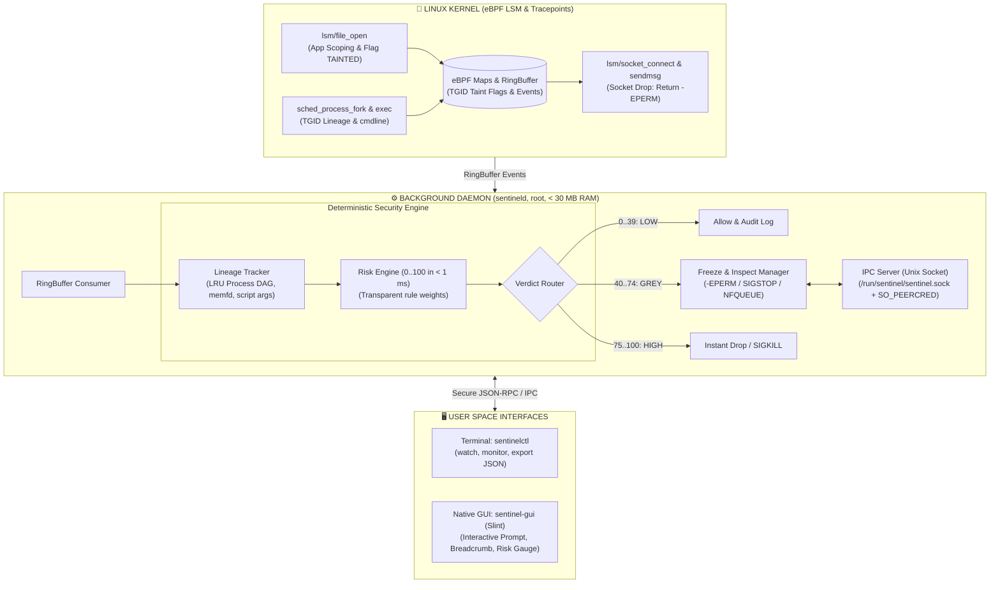

# 🛡️ Sentinel-RS

**eBPF Desktop Anti-Stealer & Deterministic Context-Aware Firewall for Linux**

[](https://www.rust-lang.org/)
[-blue.svg?logo=linux)](https://ebpf.io/)
[](https://slint.dev/)
[](https://github.com/woifik560/sentinel-rs)
[](#-key-features)
[](LICENSE)
[](https://www.debian.org/)

**English** | [Русский](README.md)

---

## 📌 Overview (Version 2.0)

**Sentinel-RS** is an ultra-lightweight host firewall and data integrity system for Linux Desktop environments, engineered specifically to prevent **infostealers** and unauthorized credential exfiltration.

Unlike traditional packet filters (`iptables`, `nftables`, `ufw`), which lack awareness of data origin, and bulky endpoint protection agents with unpredictable LLMs or opaque heuristics, Sentinel-RS combines:
1. **Linux Kernel Rigor (eBPF LSM)** with in-kernel **Taint Tracking**.
2. **Deterministic In-Memory Causal Lineage Tracking** of process hierarchies.
3. **Context-Aware Interactive Prompts ("Freeze & Inspect")** for ambiguous actions, preventing false positives.

> **💡 Architectural Principle V2.0:** No embedded Large Language Models (LLMs) in the security core! The daemon eliminates hallucinations, runs without AVX2 instruction requirements, makes decisions in **< 1 millisecond**, and consumes **under 25–30 MB of RAM**.

---

## ✨ Key Features

- 🔒 **eBPF LSM Taint Tracking & App Scoping**:
  - Access to sensitive credentials (Telegram `tdata`, browser cookies/logins, SSH/GPG keys, crypto wallets) is strictly guarded by application origin.
  - Unauthorized reads mark the entire process group (`TGID`) as `TAINTED`.
- 🧬 **Causal Lineage Graph (In-Memory Process DAG)**:
  - Tracks process ancestry (`sched_process_fork` / `exec`) inside a ring LRU graph (4096–8192 nodes).
  - Ancestry is preserved even after intermediate parents (e.g., `sh -c` or npm build scripts) terminate.
- 🔍 **Deep Execution Context Inspection**:
  - Script interpreter inspection (`python3`, `bash`, `node`, `perl`): trustworthiness is judged by the script and arguments, not the system binary hash.
  - Detection of fileless execution from RAM (`memfd_create`).
- 🛑 **Deterministic Sub-millisecond Risk Engine (0..100)**:
  - Completely transparent, human-auditable rule weights (no black-box models).
  - Categorization into **LOW** (0..39), **GREY** (40..74), and **HIGH** (75..100).
- ✋ **Interactive "Freeze & Inspect" Prompts**:
  - For ambiguous events (GREY): immediate socket rejection (`-EPERM`) + `SIGSTOP`, surfacing an interactive dialog in Slint GUI or CLI.
  - Phase 2: zero-drop packet retention via `NFQUEUE` without breaking active user workflows.
  - **Fail-Closed Principle**: unhandled prompts time out in 30 seconds, automatically dropping the connection.
- 🛡️ **IPC Security via `SO_PEERCRED`**:
  - Unix Domain Socket commands are only accepted from `root` or the UID of the active desktop user session.
- ⚡ **Extreme Lightweight Footprint**:
  - Daemon memory: **< 25–30 MB RAM**
  - Slint GUI: **< 30 MB RAM**
  - **No Python, Electron, or C++ dependencies!** Pure Rust stack.
  - Broad hardware compatibility: fully functional on legacy x86_64 CPUs (e.g. Intel Sandy Bridge without AVX2).

---

## 🏗 System Architecture



---

## ⚖️ Transparent Risk Scoring

Every event is evaluated against a deterministic scoring table (`clamp(0, 100)`):

| Rule ID | Weight | Reason |
|---|:---:|---|
| `FILELESS_MEMFD` | **+50** | Execution directly from anonymous memory (`memfd_create`) |
| `SECRET_NON_OWNER` | **+40** | Secret access by an application not authorized in App Scope |
| `UNTRUSTED_BINARY_ORIGIN` | **+25** | Executable/script located in `/tmp`, `/dev/shm`, `~/Downloads`, or unmanaged by `dpkg` |
| `SUSPICIOUS_INTERPRETER` | **+20** | Interpreter executed with inline code (`-c`), `base64`, `eval`, or piped from web |
| `FAST_EXFIL_BURST` | **+15** | Outbound network connection attempted within <= 5s of reading a secret |
| `RAW_IP_CONNECT` | **+10** | Direct connection to raw IP without preceding DNS query |
| `TRUSTED_PACKAGE_CONTEXT` | **-35** | Binary integrity verified against system package manager database |

### Verdict Thresholds:
* **0..39 (LOW):** Allowed and recorded in audit log.
* **40..74 (GREY):** Interactive user prompt in GUI or `sentinelctl watch`. Defaults to **Fail-Closed (Blocked)** after a 30s timeout.
* **75..100 (HIGH):** Immediate kernel drop (`-EPERM`), optional process freeze, and priority alert.

---

## 💻 CLI Usage (`sentinelctl`)

```bash
# Real-time interactive terminal prompt mode (ideal for SSH/servers)
sentinelctl watch

# TUI monitor streaming process accesses and network sockets
sentinelctl monitor

# Unfreeze a mistakenly flagged process
sentinelctl unfreeze <TGID>

# Export forensic incident report in JSON format (BYO-AI / SIEM analysis)
sentinelctl export <INCIDENT_ID> --format json

# Manage whitelist
sentinelctl whitelist list
sentinelctl whitelist add /usr/bin/curl
```

---

## 📦 Cargo Workspace Structure

```text
sentinel-rs/
├── crates/
│   ├── sentinel-common/   # Shared types, eBPF event formats, IPC protocol, risk models
│   ├── sentinel-ebpf/     # Kernel programs (Aya eBPF, LSM hooks, RingBuffer)
│   ├── sentineld/         # Root daemon (Lineage Tracker, Risk Engine, IPC)
│   ├── sentinelctl/       # Terminal client (CLI, watch, monitor, export)
│   └── sentinel-gui/      # Native Slint UI (incident modal dialogs, system tray)
├── config/
│   ├── config.toml        # Core firewall settings and whitelists
│   └── rules.toml         # Risk Engine weights and thresholds
├── README.md              # Documentation (Russian)
├── README.en.md           # Documentation (English)
└── ТЗ.txt                 # Full technical specification (v2.0)
```

---

## 🗺 Roadmap (V2.0)

- [x] **Milestone 1: V2.0 Architecture & Design Specifications**
  - Removal of LLM dependencies, strict RAM budget < 30 MB.
  - Causal Lineage DAG & Deterministic Risk Engine design.
- [ ] **Milestone 2: Shared Types (`sentinel-common`)**
  - eBPF events, `ProcessNode`, and IPC serialization formats.
- [ ] **Milestone 3: Kernel eBPF Module (`sentinel-ebpf`)**
  - LSM hooks (`file_open`, `socket_connect`, `socket_sendmsg`, `sched_process_fork/exec`).
- [ ] **Milestone 4: Daemon Engine (`sentineld`)**
  - In-memory process LRU graph, `memfd` detection, interpreter inspection, risk scoring.
- [ ] **Milestone 5: IPC & CLI (`sentinelctl watch`)**
  - `SO_PEERCRED` validation, terminal interactive triage.
- [ ] **Milestone 6: Native Slint GUI (`sentinel-gui`)**
  - Incident prompt dialog with breadcrumbs, fail-closed countdown, system tray.
- [ ] **Milestone 7: Zero-Drop NFQUEUE Integration (Phase 2 Prompt)**
- [ ] **Milestone 8: Test Harness & Debian Package Packaging**

---

## 📜 License

Dual-licensed under **MIT** and **GPL-2.0** (required for Linux kernel eBPF components). See [LICENSE](LICENSE) for details.
