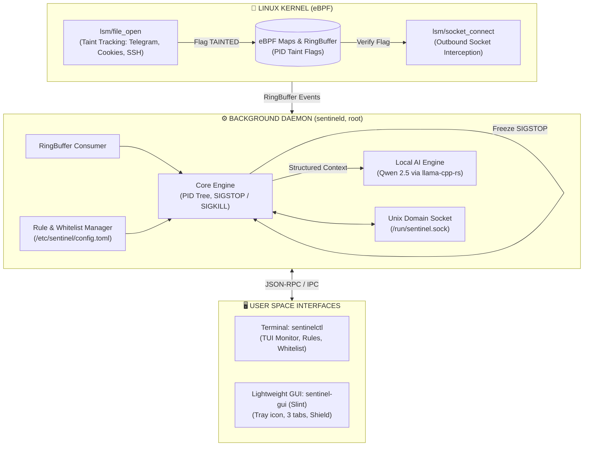

# 🛡️ Sentinel-RS

**eBPF Desktop Anti-Stealer & Local AI Triage Firewall for Linux**

[](https://www.rust-lang.org/)
[-blue.svg?logo=linux)](https://ebpf.io/)
[](https://slint.dev/)
[-green.svg)](https://huggingface.co/Qwen)
[](LICENSE)
[](https://www.debian.org/)

**English** | [Русский](README.md)

---

## 📌 Overview

**Sentinel-RS** is an ultra-lightweight hybrid host firewall and data-exfiltration defense system designed for Linux Desktop environments. It focuses on detecting and blocking **infostealers** and unauthorized data exfiltration attempts.

Unlike traditional packet filters (`iptables`, `nftables`, `ufw`), which lack awareness of process data origins, Sentinel-RS introduces **in-kernel Taint Tracking** via **eBPF LSM**.

When an untrusted process reads sensitive files (Telegram desktop sessions, browser cookies, private SSH keys, cryptocurrency wallets), the Linux kernel marks the process as `TAINTED`. The moment the process attempts to initiate an outbound network connection, it is **instantly frozen (`SIGSTOP`)** while an offline, local neural network (**Qwen 2.5 0.5B/1.5B**) performs semantic triage—without exposing user secrets to the cloud.

---

## ✨ Key Features

- 🔒 **eBPF LSM Taint Tracking**: Kernel-level VFS hook monitoring without `ptrace` or debugger overhead.
- 🛑 **Zero-Delay Process Isolation**: Freezes rogue processes via `kill(pid, SIGSTOP)` before stolen credentials can leave the network interface.
- 🧠 **Local AI Triage (Qwen 2.5)**: Autonomous semantic security reasoning (who spawned it, what files were accessed, destination IP/domain) via `llama-cpp-rs`.
- ⚡ **Resource Friendly**:
  - Background daemon: **< 50 MB RAM**
  - Desktop GUI: **< 30 MB RAM**
  - **No Electron, no Python runtime!** Pure Rust stack.
- 💻 **Legacy Hardware Friendly**: Built specifically without AVX2 requirements (full SSE4.2 / AVX-1 support for older CPUs like Intel Sandy Bridge / Ivy Bridge).
- 🎛️ **Dual Interfaces**:
  - `sentinelctl`: Streamlined CLI with a live TUI monitor and whitelist manager.
  - `sentinel-gui`: Lightweight, clean GUI built with Slint UI and system tray integration.

---

## 🏗 Architecture



---

## 🎯 Protected Targets

Sentinel-RS actively watches for unauthorized access across desktop targets:

| Category | Targets & Globs | Threat Mitigated |
|----------|-----------------|------------------|
| **Messengers** | `~/.local/share/TelegramDesktop/tdata/*` | Telegram session hijacking |
| **Browsers** | `~/.config/google-chrome/*/Cookies`<br/>`~/.config/chromium/*/Login Data`<br/>`~/.mozilla/firefox/*.default*/places.sqlite` | Session tokens, autofill passwords, browsing history |
| **Credentials** | `~/.ssh/*`, `~/.gnupg/*` | Private keys and tokens |
| **Wallets** | `~/.config/Exodus/*`, `~/.electrum/wallets/*` | Seed phrases and cryptocurrency assets |

---

## 💻 CLI Usage (`sentinelctl`)

```bash
# Check service health and AI status
sentinelctl status

# Open real-time terminal TUI monitor
sentinelctl monitor

# Whitelist trusted applications
sentinelctl whitelist add /usr/bin/curl
sentinelctl whitelist list

# Switch security policy mode (strict | balanced | learning)
sentinelctl mode balanced

# Unfreeze a mistakenly flagged process (SIGCONT)
sentinelctl unfreeze <PID>
```

---

## ⚙️ Configuration (`/etc/sentinel/config.toml`)

```toml
[general]
mode = "balanced"            # strict | balanced | learning
ai_enabled = true
auto_kill_score = 90         # Kill processes automatically if AI risk score > 90

[targets]
protect_telegram = true
protect_browsers = true
protect_ssh = true
protect_crypto = true

[whitelist]
binaries = [
    "/usr/bin/apt",
    "/usr/lib/firefox/firefox"
]
```

---

## 🛠 Tech Stack

| Domain | Technology | Reason |
|--------|------------|--------|
| **Kernel / eBPF** | [Aya](https://aya-rs.dev/) (Rust) | Safe, pure Rust eBPF development without C toolchains |
| **Daemon** | `tokio`, `clap` (Rust) | High-performance asynchronous execution and CLI parsing |
| **IPC** | `interprocess` / Unix Domain Sockets | Fast and secure communication between root daemon and unprivileged GUI |
| **AI Inference** | `llama-cpp-rs` (Qwen 2.5) | Low latency CPU inference optimized for AVX-1/SSE4.2 |
| **Desktop GUI** | [Slint UI](https://slint.dev/) (Rust) | Instant startup, native look, minimal memory footprint |
| **Notifications** | `notify-rust` (D-Bus) | Native desktop notifications |

---

## 📋 System Requirements

- **OS**: Linux Kernel **6.x+** with BTF support (tested on Debian 13 Trixie)
- **Kernel flags**: `CONFIG_DEBUG_INFO_BTF=y`, `lsm=bpf` enabled in kernel boot parameters
- **Processor**: x86_64 CPU with SSE4.2 / AVX-1 (Intel 2nd gen Sandy Bridge or newer)
- **Memory**: 4 GB RAM minimum (~380-450 MB combined RAM with model loaded)

---

## 📜 License

Licensed under dual **MIT** and **GPL-2.0** (required for Linux kernel eBPF program compatibility). See [LICENSE](LICENSE) for details.
