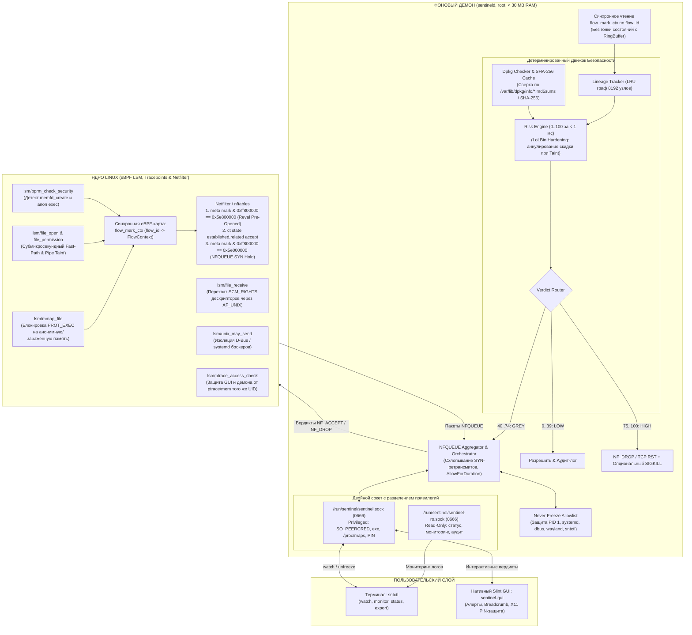

# Sentinel-RS

**eBPF Desktop Anti-Stealer & Deterministic Context-Aware Firewall for Linux**

[](https://www.rust-lang.org/)
[-blue.svg?logo=linux)](https://ebpf.io/)
[](https://slint.dev/)
[](https://github.com/woifik560/sentinel-rs)
[](#ключевые-возможности)
[](https://www.debian.org/)

[English](README.en.md) | **Русский**

---

## О проекте (Версия 2.0)

**Sentinel-RS** — это ультралегковесный хостовый фаервол и монитор целостности для Linux Desktop, нацеленный на **детерминированное предотвращение несанкционированной эксфильтрации конфиденциальных данных** пользовательскими процессами и инфостилерами (Infostealers) в рамках непривилегированной десктопной сессии.

### Границы модели угроз (Threat Model Boundaries)
Sentinel-RS спроектирован для защиты персональных данных пользователя (`~/.ssh`, токены браузеров, Telegram `tdata`, криптокошельки) от вредоносного ПО, запущенного под тем же UID пользователя (включая зависимости npm/pip/cargo, фишинговые скрипты и скомпрометированные расширения):
* **В рамках модели**: изоляция непривилегированных процессов пользователя, предотвращение отмывания taint через пайпы, сокеты AF_UNIX и `ptrace`, перехват попыток сетевого выхода через pre-opened и новые соединения, криптографическая проверка бинарников.
* **Вне модели / Архитектурные ограничения**:
  * *Полномочия Root*: если вредонос получил привилегии root (`sudo`, эксплуатация уязвимостей ядра), безопасность хоста компрометируется на уровне ядра.
  * *Среда X11*: в X11 сессиях отсутствует изоляция между окнами одного пользователя (возможны `XGetImage` и перехват клавиш). Sentinel-RS обеспечивает защиту от кликджекинга через одноразовый PIN с блокировкой после 3 неверных попыток, однако **для полной визуальной изоляции требуется сессия Wayland**.

В отличие от классических пакетных фильтров (`iptables`, `nftables`, `ufw`), которые не знают происхождения данных, и тяжелых антивирусов с непрозрачными эвристиками или нестабильными LLM, Sentinel-RS сочетает:
1. **Ядерные объектные хранилища (eBPF Object Storage)**:
   - Переход с PID/TGID карт на `BPF_MAP_TYPE_TASK_STORAGE`, `BPF_MAP_TYPE_INODE_STORAGE` и `BPF_MAP_TYPE_SK_STORAGE`. Это исключает утечки памяти и гонки при переиспользовании PID (PID reuse).
   - **Синхронизация taint между потоками (`task->group_leader`)**: taint-состояние привязано к лидеру группы потоков, поэтому чтение секрета одним потоком мгновенно блокирует сетевые сокеты всех остальных потоков этого процесса (Go goroutines, Tokio, Python, Node.js).
2. **Сквозное отслеживание потока данных (Taint Tracking) и защита от обходов**:
   - `lsm/file_permission`: перехватывает перетекание секретов через пайпы (`cat ~/.ssh/id_rsa | curl ...`), FIFO и временные файлы (`/tmp`).
   - `lsm/file_receive`: перехватывает передачу файловых дескрипторов между процессами через `SCM_RIGHTS` в AF_UNIX сокетах.
   - `lsm/mmap_file`: отслеживает отображение файлов в память; блокирует исполнение (`PROT_EXEC`) анонимной/заражённой памяти и memfd-загрузчиков, сохраняя полную совместимость с JIT-рантаймами (V8, SpiderMonkey, JVM, Node.js).
   - `lsm/unix_may_send` & `LineageTracker`: блокирует отмывание taint через сокеты AF_UNIX и пресекает побег через брокеры D-Bus (`systemd-run`, `org.freedesktop.systemd1`, порталы) связыванием причинно-следственной цепочки порождения.
   - `lsm/ptrace_access_check` и самозащита ядра: блокирует `ptrace`, `process_vm_readv/writev` и доступ к `/proc/<pid>/mem` как для демона `sentineld`, так и для интерфейса `sentinel-gui` от любых процессов пользователя того же UID.
3. **Согласованный порядок сетевых хуков и разделение Fast-Path / Slow-Path**:
   - *Порядок хуков в ядре*: учитывается, что `cgroup_skb/egress` вызывается в `ip_finish_output()` (после цепочек Netfilter output/postrouting). Поэтому Sentinel-RS применяет двухфазную защиту:
     1. В контексте системного вызова `lsm/socket_sendmsg`: немедленный возврат `-EPERM` для HIGH-риска (пакет даже не генерируется сетевым стеком ядра).
     2. В `cgroup/sendmsg4|6`, `cgroup/connect4|6` и `sock_ops`: выставление `SO_MARK` через `bpf_setsockopt` непосредственно на структуре сокета **до** прохождения Netfilter.
     3. В `cgroup_skb/egress`: мгновенный сброс пакетов (`return 0`) как аппаратный предохранитель для заражённых задач с пакетами в очереди.
   - *Синхронная корреляция dynamic mark без битовых коллизий*:
     - Биты `[31:24]` = `0x5E` (Sentinel magic byte)
     - Бит `[23]` = `0x00800000` (флаг `REVAL_PREOPENED`)
     - Биты `[22:0]` = `flow_id` (до 8.3 млн одновременных потоков)
     - Новое соединение (SYN): `mark = 0x5E000000 | flow_id`
     - Перепроверка открытого сокета: `mark = 0x5E800000 | flow_id`
     - Контекст сохраняется в синхронную BPF-карту `flow_mark_ctx` по `flow_id` до отправки пакета. При получении пакета из очереди демон мгновенно читает контекст процесса.
   - *Правила Netfilter с защитой от сбоев (Queue Bypass)*:
     1. `meta mark & 0xff800000 == 0x5e800000 counter queue num 100 bypass` (Reval Pre-Opened)
     2. `ct state established,related accept` (Линейный Fast-Path в ядре)
     3. `ct state new meta mark & 0xff800000 == 0x5e000000 counter queue num 100 bypass` (New SYN hold)
     Опция `bypass` гарантирует, что в случае остановки или аварии демона сетевой стек десктопа не блокируется полностью (Fail-Safe режим).
4. **Защита от LoLBin-атак (Living off the Land) и TOFU**:
   - Абстракция провайдеров целостности (`PkgIntegrityProvider`): проверка принадлежности пакетам с использованием MD5 только как первичного признака и локальным кэшем SHA-256 как криптографического эталона.
   - Скидка доверия пакету (`-35`) аннулируется при наличии taint (`SECRET_NON_OWNER`) или выполнении скриптов через pipe/inline-аргументы.
   - Механизм **TOFU (Trust On First Use)** для внешнего софта (`~/.cargo/bin`, Flatpak, AppImage, локальные бинарники).
5. **Разделение сокетов и строгая верификация GUI-клиента (P0)**:
   - **Два раздельных Unix-сокета**:
     - `/run/sentinel/sentinel-ro.sock` (0666): публичный read-only канал для команд мониторинга и статуса (`sntctl monitor`, `sntctl status`, `sntctl export`).
     - `/run/sentinel/sentinel.sock` (0666, строгая аутентификация post-accept): канал управления, доступный для подключения непривилегированному десктопному GUI без ошибки ядра `EACCES`.
   - **Строгая верификация peer-процесса и защита от TOCTOU**:
     - Чтение `SO_PEERCRED` (`uid` и `pid`). Если `uid == 0`, выдаются права администратора.
     - Валидация канонического пути `/proc/<pid>/exe`, проверка root-владения бинарником (`uid == 0`), прав (`mode & 0o022 == 0`) и SHA-256.
     - Проверка очистки переменных окружения от `LD_PRELOAD`, `LD_AUDIT`, `LD_LIBRARY_PATH` через `/proc/<pid>/environ`.
     - **Анти-TOCTOU инспекция `/proc/<pid>/maps`**: даже если конструктор библиотеки очистил `environ` в памяти процесса перед `connect()`, демон сканирует карту памяти процесса. Наличие исполняемых отображений (`r-xp`) из `/tmp`, `/dev/shm`, `~` или удалённых файлов немедленно отклоняет подключение.
   - **Защита от X11-кликджекинга**: детекция X11-сессии, запрос динамического 4-значного PIN-кода и автоматическая блокировка после 3 неверных попыток.
6. **Предохранитель Never-Freeze Allowlist и защита от DoS**:
   - Жесткий список защиты рабочего стола (PID 1, `systemd*`, `dbus*`, `gnome-shell`, `kwin*`, `sway`, `hyprland`, `pipewire`, `NetworkManager`, `sntctl`).
   - **Anti-Spoofing**: валидация только по связке `(dev, inode)` и каноническому пути бинарника. Подмена `comm` через `prctl(PR_SET_NAME)` игнорируется.
   - Защита очереди NFQUEUE от DoS-спама (`pending_queue_size = 512`, агрегация повторных SYN-ретрансмитов, опция временного разрешения `AllowForDuration`).
   - **Корректные требования к ядру и CVE-2026-64192**: проверка наличия `bpf` в `/sys/kernel/security/lsm` на ядрах 6.1.184+ является достаточной защитой от уязвимости, так как официальный патч ядра блокирует небезопасные операции с `map_type_inode_storage`.

> **Архитектурный принцип V2.0:** 100% чистый Rust (Pure-Rust). Без C/Python-рантаймов, без встроенных LLM в ядре безопасности! Демон не подвержен галлюцинациям, принимает решения за **< 1 миллисекунды** и потребляет **менее 25–30 МБ оперативной памяти**.

---

## Требования к ядру и настройка GRUB

Sentinel-RS использует BPF LSM хуки, которые должны быть активированы при загрузке ядра.

### Настройка для Ubuntu / Debian:
1. Откройте файл `/etc/default/grub` с правами суперпользователя:
   ```bash
   sudo nano /etc/default/grub
   ```
2. Убедитесь, что в параметр `GRUB_CMDLINE_LINUX` добавлен `bpf` в список LSM модулей:
   ```bash
   GRUB_CMDLINE_LINUX="lsm=landlock,lockdown,yama,apparmor,bpf"
   ```
3. Примените изменения и перезагрузите систему:
   ```bash
   sudo update-grub
   sudo reboot
   ```
4. Проверьте активацию BPF LSM:
   ```bash
   cat /sys/kernel/security/lsm
   # В выводе обязательно должно присутствовать слово 'bpf'
   ```

---

## Архитектура системы



---

## Прозрачная шкала риска (Risk Engine)

Каждое событие оценивается по детерминированной таблице весов (`clamp(0, 100)`):

| Правило | Вес | Описание причины |
|---|:---:|---|
| `FILELESS_MEMFD` | **+50** | Запуск кода напрямую из оперативной памяти (`memfd_create`) |
| `FILELESS_ANON_EXEC` | **+35** | Выполнение кода через `mmap` с `PROT_EXEC` на анонимную память или deleted-файл |
| `SECRET_NON_OWNER` | **+40** | Доступ к секрету или наследование taint через pipe/файл/SCM_RIGHTS процессом вне App Scope |
| `UNTRUSTED_BINARY_ORIGIN` | **+25** | Запуск из `/tmp`, `/dev/shm`, `~/Downloads` или отсутствие верификации в `dpkg` |
| `SUSPICIOUS_SCRIPT_EXECUTION` | **+25** | Выполнение скрипта из анонимного источника, stdin или с подозрительными флагами запуска |
| `SUSPICIOUS_INTERPRETER` | **+20** | Интерпретатор запущен с inline-кодом (`-c`, `-e`), eval, base64 или получен через pipe |
| `FIRST_SEEN_DESTINATION` | **+15** | Первое подключение процесса к внешнему публичному IP-адресу (вне RFC1918 и loopback) |
| `FAST_EXFIL_BURST` | **+15** | Попытка сетевого подключения в течение <= 5 сек после факта чтения секрета |
| `RAW_IP_CONNECT` | **+10** | Сетевое подключение напрямую по IP без зафиксированного DNS-запроса |
| `TRUSTED_PACKAGE_CONTEXT` | **-35** | Бинарник верифицирован в пакетах `dpkg` по SHA-256 и запущен штатно (**НЕ действует при Taint или пайпе!**) |

---

## Управление через CLI (`sntctl`)

Утилита управления переименована в `sntctl` во избежание конфликтов пространства имен:

```bash
# Интерактивный триаж в реальном времени (для серверов и SSH) [Требует Root]
sudo sntctl watch

# Live-монитор событий безопасности и сетевых попыток [Read-Only, без root]
sntctl monitor

# Просмотр статистики и состояния демона [Read-Only, без root]
sntctl status

# Разморозить ошибочно заблокированный процесс по PID [Требует Root]
sudo sntctl unfreeze <TGID>

# Экспорт криминалистического отчета в JSON [Read-Only]
sntctl export <INCIDENT_ID> --format json

# Управление белым списком доверенных бинарников
sntctl whitelist list
sudo sntctl whitelist add /usr/bin/curl

# Комплексная диагностика системы и готовности к защите
sntctl doctor
```

---

## Структура проекта (Cargo Workspace)

```text
sentinel-rs/
├── crates/
│   ├── sentinel-common/            # Общая библиотека типов, протоколов и моделей
│   │   ├── events.rs               # eBPF-события, dynamic mark (0x5E17xxxx), FlowContext, MmapFile, FileReceive
│   │   ├── process.rs              # ProcessNode, baseline profile, shell isolation, group_leader
│   │   ├── risk.rs                 # Детерминированный движок риска, LoLBin floor, TOFU, RuleId
│   │   ├── ipc.rs                  # Форматы сообщений Unix IPC, ClientRole, X11 PIN, AllowForDuration
│   │   ├── incident.rs             # Форматирование криминалистических отчетов
│   │   └── config.rs               # Конфигурация двойного сокета, NFQUEUE, Never-Freeze allowlist, context_rules
│   │
│   ├── sentinel-ebpf/              # eBPF LSM хуки, tracepoints и объектные хранилища
│   │   ├── maps.rs                 # TASK_STORAGE, INODE_STORAGE, flow_mark_ctx, TaintHygiene, ptrace self-defense
│   │   ├── loader.rs               # Загрузчик программ, preflight-проверки ядра, RingBuffer listener
│   │   └── programs/
│   │       ├── file_open.rs        # lsm/file_open: строго приватные секреты & /proc/*/environ
│   │       ├── file_permission.rs  # lsm/file_permission: субмикросекундный Fast-Path & pipe taint
│   │       ├── mmap_file.rs        # lsm/mmap_file: блокировка исполнения анонимной/зараженной памяти
│   │       ├── file_receive.rs     # lsm/file_receive: перехват SCM_RIGHTS в AF_UNIX сокетах
│   │       ├── bprm_check_security.rs # lsm/bprm_check_security: раннее профилирование & memfd
│   │       ├── unix_may_send.rs    # lsm/unix_may_send: изоляция брокеров D-Bus / systemd
│   │       ├── ptrace_access_check.rs # lsm/ptrace_access_check: запрет памяти GUI и демона от процессов того же UID
│   │       ├── socket_connect.rs   # Dynamic mark (0x5E170000 | flow_id) и BPF flow_mark_ctx
│   │       └── socket_sendmsg.rs   # Защита established-сокетов: revalidation mark 0x40000000 | flow_id
│   │
│   ├── sentineld/                  # Основной системный демон (Root, RAM < 30 MB)
│   │   ├── main.rs                 # Точка входа, event loop, интеграция сокетов и NFQUEUE
│   │   ├── preflight.rs            # Проверка BPF LSM в ядре и CVE-2026-64192 (6.1.184+)
│   │   ├── lineage.rs              # LRU DAG на 8192 узла с shell isolation и group_leader
│   │   ├── risk_engine.rs          # Расчет риска за < 1 мс, FirstSeenDestination, TOFU
│   │   ├── pkg_check.rs            # Верификация SHA-256 с канонизацией симлинков и root-владения
│   │   ├── sha_cache.rs            # Кэш SHA-256 с инвалидацией при записи и rename/unlink
│   │   ├── freeze.rs               # NFQUEUE Hold Manager, дедупликация SYN-ретрансмитов, AllowForDuration
│   │   ├── ipc_server.rs           # Двойной сокет: /run/sentinel/sentinel.sock (0750) и sentinel-ro.sock (0666)
│   │   └── tests/
│   │       ├── red_team.rs         # Базовый набор атак
│   │       └── adversarial_e2e.rs  # Полный E2E-сьют из 10 сложных adversarial-сценариев
│   │
│   ├── sntctl/                     # Консольная утилита управления (CLI Triage)
│   └── sentinel-gui/               # Легковесный Desktop UI (Slint, RAM < 30 MB, X11 PIN-защита)
│
├── config/
│   ├── config.toml                 # SO_MARK, NFQUEUE, пути к обоим сокетам, Never-Freeze список
│   ├── rules.toml                  # Веса правил (включая FILELESS_ANON_EXEC, SUSPICIOUS_SCRIPT_EXECUTION)
│   └── sentineld.service           # Systemd unit с минимизацией capabilities и OOMScoreAdjust=-900
└── ТЗ.txt                          # Полное техническое задание проекта
```
