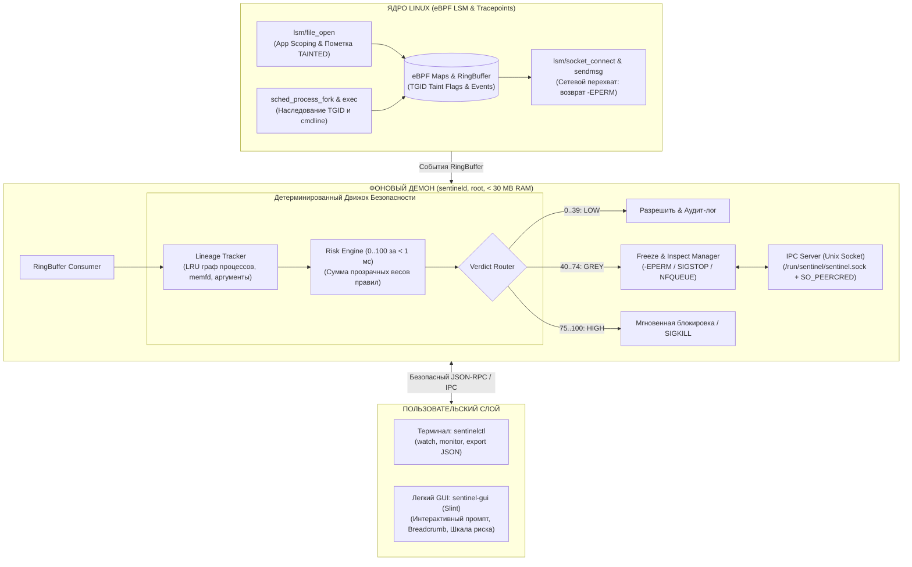

# Sentinel-RS

**eBPF Desktop Anti-Stealer & Deterministic Context-Aware Firewall for Linux**

[](https://www.rust-lang.org/)
[-blue.svg?logo=linux)](https://ebpf.io/)
[](https://slint.dev/)
[](https://github.com/woifik560/sentinel-rs)
[](#ключевые-возможности)
[](https://www.debian.org/)

[English](README.en.md) | **Русский**

---

## О проекте (Версия 2.0)

**Sentinel-RS** — это ультралегковесный хостовый фаервол и монитор целостности для Linux Desktop, нацеленный на гарантированное предотвращение работы **инфостилеров** (Infostealers) и несанкционированной эксфильтрации конфиденциальных данных.

В отличие от классических пакетных фильтров (`iptables`, `nftables`, `ufw`), которые не знают происхождения данных, и тяжелых антивирусов с непрозрачными эвристиками или нестабильными LLM, Sentinel-RS сочетает:
1. **Аппаратную строгость ядра Linux (eBPF LSM)** с отслеживанием происхождения данных (**Taint Tracking**).
2. **Детерминированный причинно-следственный граф процессов (Causal Lineage Tracker)** в памяти демона.
3. **Интерактивный контекстный контроль («Freeze & Inspect»)** в сомнительных случаях без ложных блокировок.

> **Архитектурный принцип V2.0:** Никаких встроенных нейросетей (LLM) в ядре безопасности! Демон не подвержен галлюцинациям, не требует инструкций AVX2, принимает решения за **< 1 миллисекунды** и потребляет **менее 25–30 МБ оперативной памяти**.

---

## Ключевые возможности

- **eBPF LSM Taint Tracking & App Scoping**:
  - Чтение секретов (Telegram `tdata`, куки браузеров, ключи SSH/GPG, криптокошельки) контролируется по принципу легитимного владения.
  - При несанкционированном доступе группа потоков (`TGID`) помечается флагом `TAINTED`.
- **Causal Lineage Graph (DAG предков в памяти)**:
  - Отслеживание полной цепочки порождения процессов (`sched_process_fork` / `exec`) в кольцевом LRU-графе на 4096–8192 узлов.
  - Связь сохраняется, даже если промежуточный родитель (например, `sh -c` или сборщик npm) уже завершил работу.
- **Глубокий анализ контекста запуска**:
  - Инспекция скриптов интерпретаторов (`python3`, `bash`, `node`, `perl`): доверие оценивается по скрипту и аргументам, а не по системному бинарнику.
  - Детекция бесфайлового исполнения из оперативной памяти (`memfd_create`).
- **Детерминированный движок риска (0..100) за < 1 мс**:
  - Полностью прозрачные математические веса правил (без «черных ящиков»).
  - Автоматическая классификация: **LOW** (0..39), **GREY** (40..74), **HIGH** (75..100).
- **Интерактивный промпт («Freeze & Inspect»)**:
  - Для серой зоны (GREY): мгновенный сброс сетевого вызова (`-EPERM`) + `SIGSTOP` с выводом модального окна в GUI или терминале.
  - Этап 2: бесшовное удержание пакета в `NFQUEUE` без разрыва соединения до ответа пользователя.
  - Принцип **Fail-Closed**: если пользователь не ответил за 30 секунд — соединение блокируется.
- **Защита IPC через `SO_PEERCRED`**:
  - Управляющие вердикты принимаются только от root или UID текущей активной десктопной сессии.
- **Экстремальная легковесность**:
  - Фоновый демон: **< 25–30 МБ RAM**
  - Десктопный GUI: **< 30 МБ RAM**
  - **Никакого Python, Electron или C++ зависимостей!** 100% Rust.
  - Совместим с любыми процессорами x86_64 (включая Intel Sandy Bridge 2nd gen без AVX2).

---

## Архитектура системы



---

## Прозрачная шкала риска (Risk Engine)

Каждое событие оценивается по детерминированной таблице весов (`clamp(0, 100)`):

| Правило | Вес | Описание причины |
|---|:---:|---|
| `FILELESS_MEMFD` | **+50** | Запуск кода напрямую из оперативной памяти (`memfd_create`) |
| `SECRET_NON_OWNER` | **+40** | Доступ к секрету процессом, не являющимся легитимным владельцем |
| `UNTRUSTED_BINARY_ORIGIN` | **+25** | Запуск из `/tmp`, `/dev/shm`, `~/Downloads` или отсутствие в пакетах `dpkg` |
| `SUSPICIOUS_INTERPRETER` | **+20** | Интерпретатор запущен с флагами `-c`, `base64`, `eval` или из pipe |
| `FAST_EXFIL_BURST` | **+15** | Попытка подключения к сети в течение <= 5 сек после чтения секрета |
| `RAW_IP_CONNECT` | **+10** | Подключение напрямую по IP-адресу без предварительного DNS-запроса |
| `TRUSTED_PACKAGE_CONTEXT` | **-35** | Бинарник верифицирован в пакетах системы и запущен в штатном контексте |

### Пороги принятия решений:
* **0..39 (LOW):** Разрешить и зафиксировать в аудит-логе.
* **40..74 (GREY):** Интерактивный запрос пользователю в `sentinel-gui` или `sentinelctl watch`. При отсутствии ответа за 30 сек — **Fail-Closed (Блокировка)**.
* **75..100 (HIGH):** Мгновенная блокировка (`-EPERM`), опциональная заморозка нарушителя и алерт.

---

## Интерактивный контроль («Freeze & Inspect»)

Вместо непредсказуемых вердиктов ИИ Sentinel-RS показывает понятную для человека причинно-следственную цепочку:

```text
ПОДОЗРИТЕЛЬНАЯ АКТИВНОСТЬ (Риск: 85/100)
Цепочка: bash (PID 1204) -> npm (PID 1420) -> python3 (/tmp/install.py)
Событие: Прочитан файл ~/.ssh/id_ed25519 (0.14 сек назад)
Назначение: Исходящее подключение -> 185.220.101.5:443 (Без DNS)
Сработавшие правила:
  [+40] Доступ к SSH-ключам неуполномоченным процессом
  [+25] Скрипт запущен из /tmp
  [+15] Попытка эксфильтрации в течение 5 секунд
  [+10] Прямое подключение по IP-адресу

Действия: [Убить процесс (SIGKILL)] [Разрешить разово] [Добавить в правила]
(Автоматическая блокировка через 24 сек...)
```

---

## Управление через CLI (`sentinelctl`)

```bash
# Интерактивный перехват событий в реальном времени (для серверов и SSH)
sentinelctl watch

# TUI-монитор активности процессов и сетевых запросов
sentinelctl monitor

# Разморозить ошибочно заблокированный процесс
sentinelctl unfreeze <TGID>

# Экспорт обезличенного криминалистического отчета (Forensics / BYO-AI)
sentinelctl export <INCIDENT_ID> --format json

# Управление доверенными приложениями
sentinelctl whitelist list
sentinelctl whitelist add /usr/bin/curl
```

---

## Структура проекта (Cargo Workspace)

Проект организован в виде модульного Rust-воркспейса с четким разделением ответственности между ядром, демоном и пользовательскими клиентами:

```text
sentinel-rs/
├── crates/
│   ├── sentinel-common/            # Общая библиотека типов, протоколов и моделей
│   │   ├── Cargo.toml
│   │   └── src/
│   │       ├── lib.rs              # Точка входа библиотеки
│   │       ├── events.rs           # eBPF-события ядра (file_open, fork, exec, socket_connect)
│   │       ├── process.rs          # ProcessNode, анализ интерпретаторов (python3, bash, node)
│   │       ├── risk.rs             # Детерминированный движок риска (0..100) и веса правил
│   │       ├── ipc.rs              # Форматы сообщений Unix IPC (PromptRequest, Verdict)
│   │       ├── incident.rs         # Форматирование криминалистических отчетов (Human / JSON)
│   │       └── config.rs           # Десериализация конфигураций config.toml и rules.toml
│   │
│   ├── sentinel-ebpf/              # Программы ядра Linux (Aya eBPF, LSM-хуки, карты)
│   │   ├── Cargo.toml
│   │   └── src/
│   │       ├── lib.rs              # Экспорт eBPF-структур и констант
│   │       ├── maps.rs             # TaintMapManager, RingBuffer, pending_verdicts
│   │       ├── loader.rs           # Загрузчик eBPF LSM и трассировочных программ
│   │       └── programs/
│   │           ├── mod.rs          # Модули программ ядра
│   │           ├── file_open.rs    # LSM-хук file_open: App Scoping и пометка TAINTED
│   │           ├── process_fork.rs # Трассировка fork: клонирование предков и таинта
│   │           ├── process_exec.rs # Трассировка exec: инспекция cmdline и memfd_create
│   │           ├── socket_connect.rs # LSM socket_connect: блокировка SYN (-EPERM)
│   │           └── socket_sendmsg.rs # LSM socket_sendmsg: контроль UDP/RAW передачи
│   │
│   ├── sentineld/                  # Основной системный демон (Root, RAM < 30 MB)
│   │   ├── Cargo.toml
│   │   └── src/
│   │       ├── main.rs             # Точка входа, инициализация рантайма и event loop
│   │       ├── lineage.rs          # Causal Lineage Tracker (кольцевой LRU DAG на 8192 узла)
│   │       ├── risk_engine.rs      # Расчет суммарного риска по 7 прозрачным правилам (< 1 мс)
│   │       ├── verdict.rs          # Маршрутизатор вердиктов (LOW: Allow, GREY: Prompt, HIGH: Kill)
│   │       ├── freeze.rs           # Freeze & Inspect Orchestrator (SIGSTOP, Fail-Closed 30s)
│   │       ├── ipc_server.rs       # Unix IPC сервер (/run/sentinel.sock + SO_PEERCRED)
│   │       ├── sha_cache.rs        # In-memory кэш SHA-256 хешей исполняемых файлов
│   │       └── pkg_check.rs        # Проверка происхождения бинарников через dpkg-query
│   │
│   ├── sentinelctl/                # Консольная утилита управления (CLI Triage)
│   │   ├── Cargo.toml
│   │   └── src/
│   │       └── main.rs             # Команды: watch, monitor, unfreeze, status, export, whitelist
│   │
│   └── sentinel-gui/               # Легковесный Desktop UI (Slint, RAM < 30 MB)
│       ├── Cargo.toml
│       └── src/
│           └── main.rs             # Модальное окно алерта (Slint DSL), таймер и IPC-клиент
│
├── config/
│   ├── config.toml                 # Пути к секретам, белый список приложений, настройки IPC
│   └── rules.toml                  # Детерминированные веса правил и пороги категорий риска
│
├── systemd/
│   └── sentineld.service           # Unit-файл systemd для автозапуска демона
│
├── Cargo.toml                      # Конфигурация корневого Cargo Workspace
├── Cargo.lock                      # Зафиксированные версии зависимостей
├── README.md                       # Документация и руководство (Русский)
├── README.en.md                    # Documentation & User Guide (English)
└── ТЗ.txt                          # Полное техническое задание проекта (v2.0)
```

---

## Технологический стек

| Модуль | Технология | Преимущество |
|---|---|---|
| **Ядро eBPF** | [Aya](https://aya-rs.dev/) (Rust) | Безопасная разработка под ядро без C/Clang зависимостей |
| **Фоновый демон** | `tokio`, `clap`, `sha2` (Rust) | Асинхронный быстрый рантайм, память < 30 МБ |
| **Анализ процессов** | In-Memory LRU Process DAG | Восстановление предков процессов даже после их завершения |
| **Безопасность IPC** | Unix Domain Socket + `SO_PEERCRED` | Аутентификация клиентов на уровне ядра (UID десктопной сессии) |
| **Десктопный GUI** | [Slint UI](https://slint.dev/) (Rust) | Нативный вид, запуск за 0.05 сек, память < 30 МБ |
| **Сетевой перехват** | eBPF LSM / NFQUEUE (`nftables`) | Гарантированное удержание пакетов без утечек наружу |

---

## Дорожная карта (Roadmap V2.0)

- [x] **Этап 1: Архитектурные спецификации V2.0**
  - Исключение LLM-зависимостей, фиксация лимита памяти < 30 МБ.
  - Спецификация Causal Lineage DAG и детерминированного Risk Engine.
- [x] **Этап 2: Общие структуры и типы (`sentinel-common`)**
  - Определение eBPF-событий, `ProcessNode`, IPC-протокола, парсинг конфигурации.
- [x] **Этап 3: eBPF-программы ядра (`sentinel-ebpf`)**
  - LSM-хуки `file_open`, `socket_connect`, `socket_sendmsg`, `sched_process_fork/exec`, RingBuffer и TaintMap.
- [x] **Этап 4: Демон `sentineld`**
  - LRU-граф процессов (8192 узла), детекция `memfd`, инспекция скриптов интерпретаторов, расчет риска за < 1 мс.
- [x] **Этап 5: IPC и консольный клиент (`sentinelctl`)**
  - Проверка прав `SO_PEERCRED`, интерактивный режим `sentinelctl watch`, `monitor`, `unfreeze`, `status`, `export`.
- [x] **Этап 6: Десктопный GUI (`sentinel-gui` на Slint)**
  - Верстка окна алерта с цепочкой breadcrumb, шкалой риска, таймер Fail-Closed (30с), отсутствие GPU/AVX2 зависимостей.
- [ ] **Этап 7: Zero-Drop удержание через NFQUEUE (Этап 2 промпта)**
- [ ] **Этап 8: Стендовые тесты и сборка deb-пакета**
