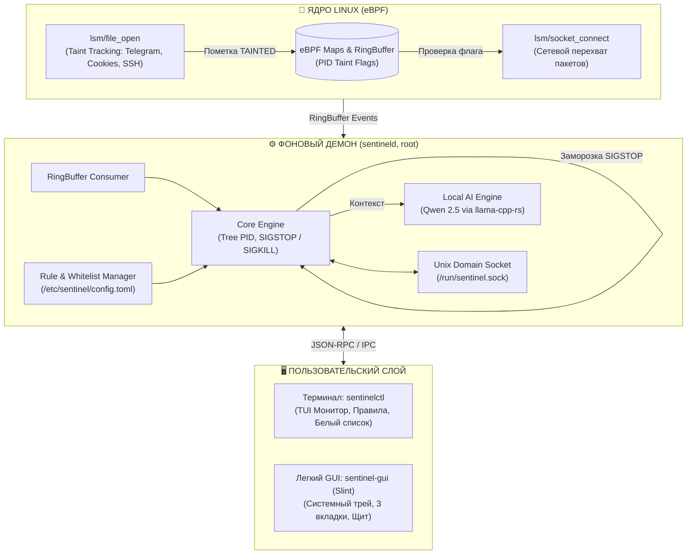

# 🛡️ Sentinel-RS

**eBPF Desktop Anti-Stealer & Local AI Triage Firewall for Linux**

[](https://www.rust-lang.org/)
[-blue.svg?logo=linux)](https://ebpf.io/)
[](https://slint.dev/)
[-green.svg)](https://huggingface.co/Qwen)
[](LICENSE)
[](https://www.debian.org/)

[English](README.en.md) | **Русский**

---

## 📌 О проекте

**Sentinel-RS** — это легковесный гибридный хостовый фаервол и монитор целостности для Linux Desktop, нацеленный на предотвращение работы **инфостилеров** (Infostealers) и несанкционированной эксфильтрации персональных данных.

В отличие от классических пакетных фильтров (`iptables`, `nftables`, `ufw`), которые не понимают контекста происхождения данных, Sentinel-RS использует механизм **Taint Tracking (отслеживание заражения потоков)** на уровне ядра Linux с помощью **eBPF LSM**.

Когда недоверенный процесс считывает чувствительные файлы (сессии Telegram, куки браузеров, приватные SSH-ключи, криптокошельки), ядро помечает процесс флагом `TAINTED`. При первой же попытке открыть сетевой сокет нарушитель **мгновенно замораживается (`SIGSTOP`)**, а метаданные передаются локальной нейросети (**Qwen 2.5 0.5B/1.5B**) для автоматического вердикта безопасности без отправки данных в облако.

---

## ✨ Ключевые возможности

- 🔒 **eBPF LSM Taint Tracking**: Перехват обращений к секретам на уровне виртуальной файловой системы без оверхеда ptrace.
- 🛑 **Zero-Delay Isolation**: Мгновенная заморозка процесса (`SIGSTOP`) до того, как украденные данные покинут сетевой интерфейс.
- 🧠 **Локальный ИИ-триаж (Qwen 2.5)**: Автономный семантический анализ (кто запустил процесс, что он прочитал, по какому адресу обращается) на базе `llama-cpp-rs`.
- ⚡ **Экстремальная легковесность**:
  - Фоновый демон: **< 50 МБ RAM**
  - Десктопный GUI: **< 30 МБ RAM**
  - **Никакого Electron или Python!** Полностью нативный стек на Rust.
- 💻 **Поддержка доступного оборудования**: Скомпилирован без жестких требований к AVX2 (полная поддержка процессоров Intel Sandy Bridge / Ivy Bridge с инструкциями SSE4.2 / AVX-1).
- 🎛️ **Двойной интерфейс**:
  - `sentinelctl` — мощная CLI/TUI утилита для гиков, терминала и скриптов.
  - `sentinel-gui` — дружелюбный нативный интерфейс на Slint UI с иконкой в трее.

---

## 🏗 Архитектура системы



---

## 🎯 Защищаемые цели

Sentinel-RS отслеживает несанкционированный доступ к критическим директориям пользователя:

| Категория | Пути и маски | Тип угрозы |
|-----------|--------------|------------|
| **Мессенджеры** | `~/.local/share/TelegramDesktop/tdata/*` | Кража активной сессии Telegram |
| **Браузеры** | `~/.config/google-chrome/*/Cookies`<br/>`~/.config/chromium/*/Login Data`<br/>`~/.mozilla/firefox/*.default*/places.sqlite` | Сессионные куки, сохраненные пароли, история |
| **Системные ключи** | `~/.ssh/*`, `~/.gnupg/*` | Приватные ключи SSH, GPG |
| **Криптокошельки** | `~/.config/Exodus/*`, `~/.electrum/wallets/*` | Seed-фразы и кошельки |

---

## 💻 Управление через CLI (`sentinelctl`)

Консольная утилита создана для системных администраторов, опытных пользователей и автоматизации:

```bash
# Проверить статус службы и состояние ИИ-движка
sentinelctl status

# Запустить TUI-монитор событий в реальном времени
sentinelctl monitor

# Добавить доверенный бинарник в белый список
sentinelctl whitelist add /usr/bin/curl
sentinelctl whitelist list

# Переключение режима работы (strict | balanced | learning)
sentinelctl mode balanced

# Разморозить ошибочно задержанный процесс (SIGCONT)
sentinelctl unfreeze <PID>
```

---

## 🖥️ Графический интерфейс (`sentinel-gui`)

Интерфейс спроектирован на базе **[Slint](https://slint.dev/)** — современного нативного GUI-фреймворка для Rust. Бинарник запускается за доли секунды и потребляет менее 30 МБ оперативной памяти.

### Основные вкладки:
1. **«Щит» (Главный экран)**:
   - Большой визуальный индикатор состояния безопасности (Зеленый / Красный щит).
   - Главный тумблер включения/выключения защиты.
   - Выбор чувствительности ИИ (Обычная / Умная / Параноик).
   - Индикатор использования оперативной памяти.
2. **«Что защищать»**:
   - Быстрые переключатели для категорий (Telegram, Браузеры, SSH, Крипта).
3. **«Белый список»**:
   - Карточки доверенных приложений с удобным добавлением через файловый менеджер.
4. **Системный трей**:
   - Быстрая пауза защиты на 15 минут, вызов дашборда и индикация статуса рядом с часами.

---

## ⚙️ Конфигурация (`/etc/sentinel/config.toml`)

```toml
[general]
mode = "balanced"            # strict (параноик) | balanced (базовый) | learning (обучение)
ai_enabled = true
auto_kill_score = 90         # Автоматический SIGKILL при уверенности ИИ > 90%

[targets]
protect_telegram = true
protect_browsers = true
protect_ssh = true
protect_crypto = true

[whitelist]
binaries = [
    "/usr/bin/apt",
    "/usr/lib/firefox/firefox"
]
```

---

## 🛠 Технологический стек

| Направление | Инструмент | Преимущество |
|-------------|------------|--------------|
| **eBPF Ядро** | [Aya](https://aya-rs.dev/) (Rust) | Безопасная разработка eBPF без C-зависимостей и LLVM clang-плагинов |
| **Фоновый демон** | `tokio`, `clap` (Rust) | Высокопроизводительный асинхронный рантайм |
| **IPC** | `interprocess` / Unix Domain Sockets | Быстрая коммуникация между root-демоном и GUI без оверхеда сети |
| **ИИ Инференс** | `llama-cpp-rs` (Qwen 2.5) | Быстрый инференс на CPU с инструкциями AVX-1/SSE4.2 |
| **Десктопный GUI** | [Slint UI](https://slint.dev/) (Rust) | Мгновенный запуск, ультранизкое потребление RAM, без Chromium |
| **Системные алерты** | `notify-rust` (D-Bus) | Нативные всплывающие уведомления среды рабочего стола |

---

## 📋 Системные требования

- **ОС**: Linux с ядром **6.x+** (протестировано на Debian 13 Trixie)
- **Параметры ядра**: `CONFIG_DEBUG_INFO_BTF=y`, включенный `eBPF LSM` (`lsm=bpf` в grub cmdline)
- **Процессор**: x86_64 с поддержкой SSE4.2 / AVX (Intel Sandy Bridge 2-го поколения и новее)
- **Оперативная память**: от 4 ГБ (демон с моделью ИИ занимает ~380-450 МБ RAM суммарно)

---

## 🗺 Дорожная карта (Roadmap)

- [x] **Этап 1: Подготовка стенда и тесты на CPU**
  - Активация `lsm=bpf` в Debian 13.
  - Бенчмарк инференса Qwen2.5-0.5B на SSE4.2 / AVX-1 (цель: < 2 сек на ответ).
- [ ] **Этап 2: Ядро и демон eBPF (Бэкэнд)**
  - Реализация хуков `lsm/file_open` для обнаружения кражи сессий.
  - Реализация `lsm/socket_connect` для сетевой блокировки.
  - Механизм мгновенной изоляции через `SIGSTOP`.
- [ ] **Этап 3: IPC и Консольный клиент (`sentinelctl`)**
  - Реализация Unix-сокета `/run/sentinel.sock` с JSON-RPC.
  - Команды `status`, `monitor`, `whitelist`, `mode`, `unfreeze`.
- [ ] **Этап 4: Интеграция ИИ-триажа**
  - Пайплайн передачи метаданных нарушителя в локальную LLM.
  - Автоматический `SIGKILL` при риске > 90%.
- [ ] **Этап 5: Минималистичный GUI (`sentinel-gui`) на Slint**
  - Разработка интерфейса из 3 вкладок и системного трея.
  - Связка с демоном через IPC.
- [ ] **Этап 6: Тестирование и релиз**
  - Валидация на реальных сценариях стилеров и скриптов эксфильтрации.

---

## 📜 Лицензия

Проект распространяется под двойной лицензией **MIT** и **GPL-2.0** (для eBPF компонентов ядра в соответствии с требованиями ядра Linux). Подробнее см. в файле [LICENSE](LICENSE).
