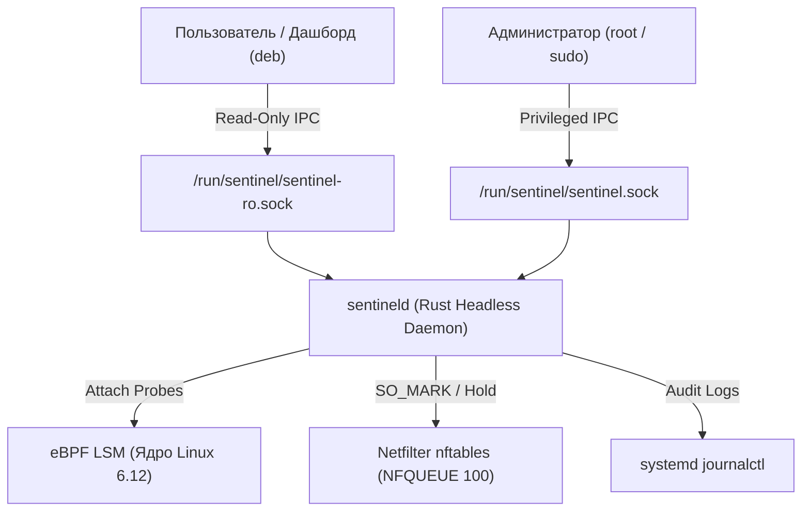

# Sentinel-RS: Руководство пользователя и сценарий живой демонстрации

> **Версия:** 0.2.1  
> **Платформа:** Linux 6.1+ (Debian 13 Trixie, Ubuntu 22.04/24.04, Kali Linux)  
> **Архитектура:** eBPF LSM + Netfilter NFQUEUE Bypass + SO_PEERCRED RBAC

---

## 1. Архитектурный обзор (Что говорить перед показом)

**Sentinel-RS** — это сверхлегковесный headless-агент класса **HIPS/EDR** (Host Intrusion Prevention System / Endpoint Detection & Response), созданный на языке Rust для Linux-серверов и рабочих станций:

- **Безопасность без модификации ядра:** Использует современный механизм **eBPF LSM** (Linux Security Modules), доступный в ванильных ядрах Linux начиная с версии 6.1. Больше не требуются сторонние модули ядра (`.ko`), которые могут привести к Kernel Panic.
- **Интеллектуальный сетевой перехват:** Интеграция с подсистемой ядра **Netfilter (nftables)** и **NFQUEUE** с ядерным флагом `bypass`. В случае подозрительной сетевой активности первичный SYN-пакет задерживается в очереди ядра для верификации контекста, не нарушая работу уже установленных сетевых соединений.
- **Минимальный оверхед ресурсов:** Потребление оперативной памяти составляет **всего ~1.0–3.0 МБ RAM** при **0% CPU** в режиме ожидания (для сравнения: коммерческие EDR вроде Falcon или Defender потребляют 300–800 МБ RAM).
- **Разделение прав (RBAC):** Двухсокетная архитектура Unix Domain Sockets:
  - `/run/sentinel/sentinel-ro.sock` (права `0666`) — безопасный доступ для мониторинга, дашбордов и рядовых пользователей без `sudo`.
  - `/run/sentinel/sentinel.sock` (права `0660 root:root`) — защищенный сокет для административных действий с проверкой учетных данных вызывающего процесса на уровне ядра (`SO_PEERCRED`).



---

## 2. Полный справочник команд `sntctl`

Утилита командной строки `sntctl` разделена на безопасные команды чтения (доступны без `sudo`) и команды управления (требуют `sudo`).

### 2.1. Диагностика и мониторинг (Без `sudo`)

| Команда | Описание | Пример вывода |
| :--- | :--- | :--- |
| `sntctl doctor` | Проверка готовности ядра, BPF LSM, сокетов и правил Netfilter | `[OK] BPF LSM: Active`, `[OK] Netfilter: Table 'inet sentinel' active` |
| `sntctl protection status` | Текущее состояние ядра защиты | `bpf_lsm: true, network_holding: true, protection_active: true` |
| `sntctl status` | Общий статус агента, роль клиента и счетчики процессов | `role: ReadOnly`, `frozen_processes: 0`, `tracked_processes: 0` |
| `sntctl health` | Проверка внутреннего состояния и ответа демона | `status: acknowledged` |
| `sntctl monitor` | Интерактивный TUI-экран мониторинга в реальном времени | Интерактивный поток системных событий |
| `sntctl --json <команда>` | Вывод результатов в структурированном JSON для скриптов | `{"role": "ReadOnly", "frozen_processes": 0}` |

### 2.2. Управление процессами и инцидентами

| Команда | Описание | Привилегии |
| :--- | :--- | :--- |
| `sntctl process inspect <PID>` | Детальный аудит атрибутов процесса, хэша, открытых дескрипторов | Чтение |
| `sntctl process lineage <PID>` | Построение полного причинно-следственного дерева предков до PID 1 | Чтение |
| `sudo sntctl process suspend <PID>` | Мгновенная криминалистическая заморозка процесса (`SIGSTOP`) | `root / sudo` |
| `sudo sntctl unfreeze <PID>` | Разморозка ранее остановленного процесса (`SIGCONT`) | `root / sudo` |
| `sudo sntctl process kill <PID> --reason "<причина>"` | Гарантированная ликвидация с защитой от подмены PID (Anti-PID-Reuse) | `root / sudo` |
| `sntctl incidents list` | Вывод списка зафиксированных инцидентов безопасности | Чтение |
| `sntctl incidents show <ID>` | Детальный криминалистический отчет по номеру инцидента | Чтение |

### 2.3. Управление сетью и политиками

| Команда | Описание | Привилегии |
| :--- | :--- | :--- |
| `sudo sntctl protection enable` | Включение активного режима блокировки угроз | `root / sudo` |
| `sudo sntctl protection disable` | Перевод в пассивный режим мониторинга | `root / sudo` |
| `sudo sntctl network isolate` | Экстренная изоляция хоста от внешней сети (сохраняет `127.0.0.1`) | `root / sudo` |
| `sudo sntctl network unisolate` | Снятие аварийной изоляции хоста | `root / sudo` |
| `sudo sntctl policy reload` | Горячая перезагрузка правил `/etc/sentinel/rules.toml` без рестарта | `root / sudo` |
| `sntctl policy validate -f <file>` | Синтаксическая валидация файла правил | Без `sudo` |

---

## 3. Сценарий живой демонстрации (Live Showcase)

Этот сценарий рассчитан на 5–10 минут живого показа перед коллегами, заказчиками или на защите проекта.

### Шаг 1. Демонстрация эффективности и нулевого следа в ресурсах

**Цель:** Показать компактность и нативную скорость без тяжелых рантаймов.

**Команды в терминале:**
```bash
systemctl status sentineld.service
```

> **Что сказать:**  
> *«Обратите внимание на статус службы: Sentinel-RS скомпилирован на Rust в нативный бинарный код. Потребление памяти составляет всего 1 мегабайт (пиковое не более 3 МБ), загрузка процессора 0%. В отличие от традиционных антивирусов, демон не замедляет работу серверов и баз данных».*

---

### Шаг 2. Глубокая системная диагностика (`doctor`)

**Цель:** Показать проверку аппаратных слоев безопасности ядра Linux.

**Команды в терминале:**
```bash
sudo sntctl doctor
```

> **Что сказать:**  
> *«Команда `sntctl doctor` опрашивает ядро Debian 13. Мы видим, что BPF LSM активирован прямо в пространстве `/sys/kernel/security/lsm`, созданы оба раздельных IPC-сокета, а в подсистеме Netfilter активно правило очереди перехвата с ядерным байпасом».*

---

### Шаг 3. Демонстрация ролевой модели безопасности (RBAC)

**Цель:** Показать, что обычный непривилегированный пользователь не может отключить защиту сервера, но может видеть статус.

**Команды в терминале:**
```bash
# 1. Запрос статуса без root (успешно)
sntctl protection status

# 2. Попытка отключить защиту без прав администратора (блокируется ядром)
sntctl protection disable
```

*Ожидаемый результат:*
```text
Error: Failed to connect to sentineld IPC socket at /run/sentinel/sentinel.sock: Permission denied (os error 13)
```

**Переключение от имени администратора:**
```bash
# 3. Успешное управление с правами root
sudo sntctl protection disable
sudo sntctl protection enable
```

> **Что сказать:**  
> *«Здесь работает двухуровневая защита: права доступа к Unix-сокету `0660` и ядерная проверка учетных данных `SO_PEERCRED`. Обычный пользователь или скомпрометированный веб-сервис не могут отключить защиту».*

---

### Шаг 4. Расследование цепочки процессов (Causal Lineage DAG)

**Цель:** Продемонстрировать способность EDR мгновенно определять, кто и откуда запустил подозрительный процесс, вплоть до `init/systemd`.

**Команды в терминале:**
```bash
# 1. Запускаем тестовый фоновый процесс
sleep 300 &
PID=$!
echo "Запущен подозрительный процесс с PID: $PID"

# 2. Инспектируем процесс
sntctl process inspect $PID

# 3. Строим полное дерево предков
sntctl process lineage $PID
```

> **Что сказать:**  
> *«Большинство вредоносных скриптов пытаются запутать пути, меняя имена или отпочковываясь в фон. Sentinel-RS хранит циклическое дерево предков в кольцевом буфере ядра. Мы видим всю генеалогическую цепочку: от `systemd (PID 1)` через `sshd`, пользовательскую оболочку `bash` и до текущего процесса».*

---

### Шаг 5. Реагирование на угрозу: Заморозка и ликвидация (Anti-PID-Reuse)

**Цель:** Показать разницу между слепым `kill -9` и защищенным криминалистическим реагированием.

**Команды в терминале:**
```bash
# 1. Мгновенно замораживаем процесс (SIGSTOP)
sudo sntctl process suspend $PID

# 2. Проверяем состояние процесса в ядре (State: T - Stopped)
ps -o pid,state,comm -p $PID

# 3. Размораживаем процесс
sudo sntctl unfreeze $PID
ps -o pid,state,comm -p $PID

# 4. Ликвидируем процесс с логированием причины
sudo sntctl process kill $PID --reason "Подозрение на утечку данных"

# 5. Демонстрация защиты нулевого уровня (попытка убить PID 1)
sudo sntctl process kill 1
```

*Ожидаемый результат попытки убить PID 1:*
```text
Error executing process action [EPERM]: Cannot terminate protected system/daemon process 1
```

> **Что сказать:**  
> *«При обнаружении угрозы оператор или автоматика может заморозить подозрительный процесс. Он перестает выполнять инструкции и отправлять пакеты, но его оперативная память сохраняется для создания дампа и криминалистического анализа. А при ликвидации Sentinel-RS проверяет стартовое время процесса, исключая ошибку Anti-PID-Reuse (когда процесс уже завершился, а его PID заняла невинная служба). Кроме того, защитное правило нулевого уровня делает невозможным завершение ядра системы или PID 1».*

---

### Шаг 6. Экстренная сетевая изоляция хоста (Emergency Containment)

**Цель:** Показать, как при обнаружении масштабной компрометации мгновенно изолировать сервер от сети хакера, не потеряв доступ к локальным сервисам.

**Команды в терминале:**
```bash
# 1. Активируем изоляцию
sudo sntctl network isolate

# 2. Проверяем локальный loopback (доступен)
ping -c 2 127.0.0.1

# 3. Проверяем внешнюю сеть (блокируется ядром Netfilter)
ping -c 1 -W 1 8.8.8.8 || echo "[БЛОКИРОВКА] Внешний трафик перекрыт!"

# 4. Снимаем изоляцию хоста
sudo sntctl network unisolate

# 5. Проверяем восстановление сети
ping -c 2 127.0.0.1
```

> **Что сказать:**  
> *«В случае атаки типа Ransomware или активной эксфильтрации данных оператор вводит `network isolate`. Sentinel-RS мгновенно изолирует сервер от внешней сети на уровне Netfilter, полностью блокируя командные центры злоумышленников, но сохраняет локальный loopback `127.0.0.1` для локального аудита».*

---

### Шаг 7. Запуск автоматического комплексного теста

**Команды в терминале:**
```bash
cd ~/sentinel-rs
sudo ./tests/run_live_vm_tests.sh
```

> **Что сказать:**  
> *«Для непрерывной проверки надежности в проект встроен сквозной тест `run_live_vm_tests.sh`, который автоматически тестирует все 8 сценариев за 10 секунд и выводит подробный зеленый отчет».*

---

## 4. Конфигурационные файлы и управление

### 4.1. Файл `/etc/sentinel/config.toml`
Определяет общие параметры работы демона:
- `mode = "balanced"` — режим работы (`strict`, `balanced`, `learning`).
- `prompt_timeout_secs = 30` — таймаут для интерактивного подтверждения до перехода в Fail-Closed.
- `ring_buffer_size = 8192` — размер кольцевого буфера истории процессов.
- `whitelist.binaries` — список системных бинарников, имеющих доверенный статус.

### 4.2. Файл `/etc/sentinel/rules.toml`
Определяет правила политик безопасности и сопоставления с базой **TOFU (Trust On First Use)**.

### 4.3. Управление системной службой
```bash
# Перезапуск службы
sudo systemctl restart sentineld

# Остановка
sudo systemctl stop sentineld

# Просмотр системного журнала в реальном времени
journalctl -u sentineld -f
```
